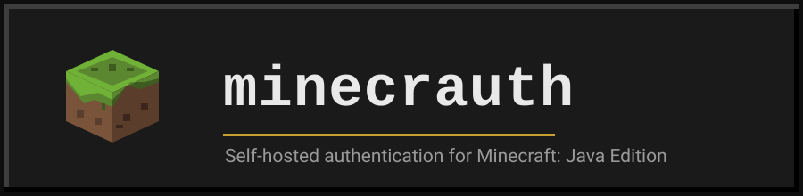
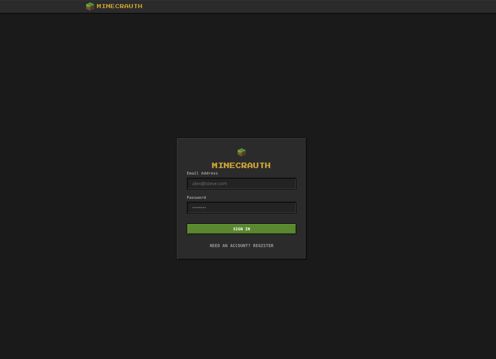
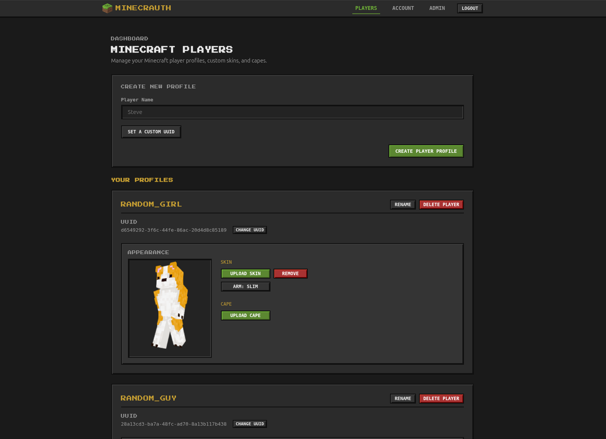
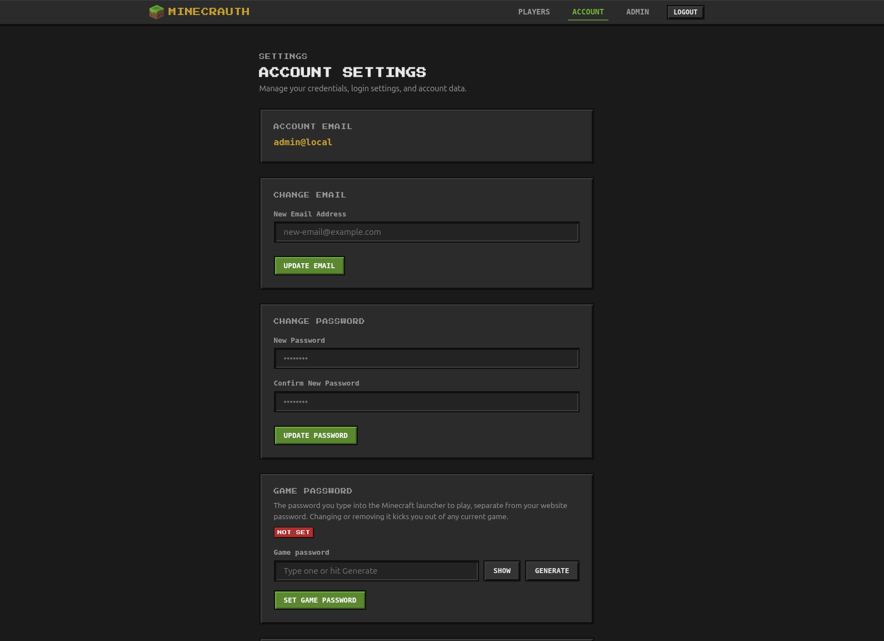
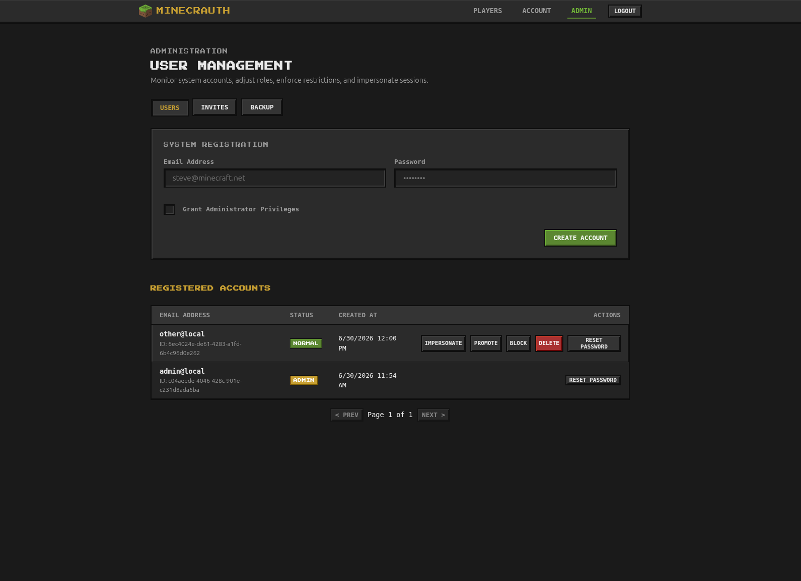
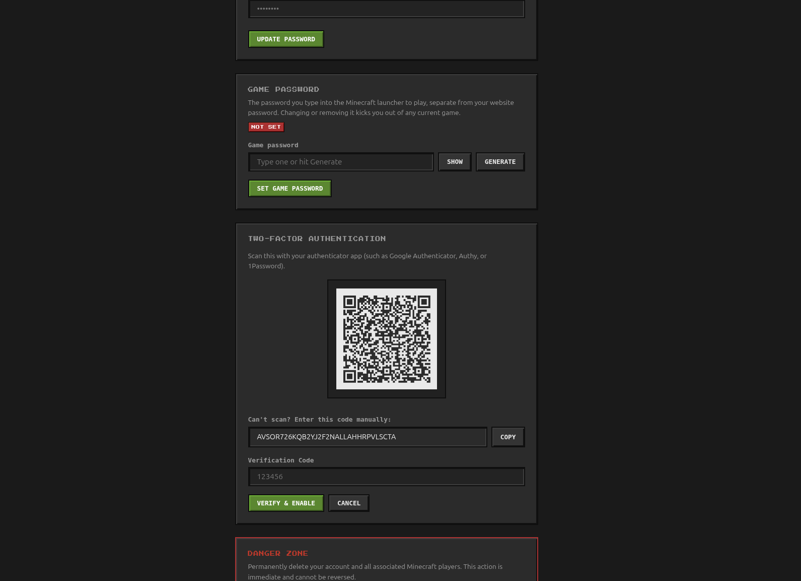

<p align="center">
  
</p>

<p align="center">
  <a href="https://goreportcard.com/report/github.com/achetronic/minecrauth">
    
  </a>
  <a href="https://github.com/achetronic/minecrauth/releases">
    
  </a>
  <a href="https://github.com/achetronic/minecrauth/actions">
    
  </a>
  <a href="https://github.com/achetronic/minecrauth/blob/main/LICENSE">
    
  </a>
  <a href="https://github.com/achetronic/minecrauth/blob/main/go.mod">
    
  </a>
  <a href="https://github.com/achetronic/minecrauth/pkgs/container/minecrauth">
    
  </a>
</p>

<p align="center">
  <i>A self-hosted Yggdrasil authentication server for Minecraft Java Edition with skins and capes</i>
</p>

## Table of Contents

- [Features \& Screenshots](#features--screenshots)
- [What It Is / What It Is Not](#what-it-is--what-it-is-not)
- [Quick Start](#quick-start)
- [Configuration](#configuration)
- [Connecting Clients and Servers](#connecting-clients-and-servers)
- [The Web UI](#the-web-ui)
- [Docs](#docs)
- [License](#license)

## Features & Screenshots

- **Full Yggdrasil flow:** authenticate, refresh, validate, invalidate, signout, join, hasJoined, name lookup, and RSA-signed texture profiles.
- **Many players per account:** one account owns several characters, handy for alts, camera accounts and AFK bots.
- **Skins and capes:** upload by file or URL, with a 3D preview and slim/classic arm detection.
- **Mixed authentication:** delegate to fallback servers like Mojang so local and real Mojang accounts join the same server.
- **OIDC for the web UI:** sign in through Keycloak, Kanidm, Authelia, Google and friends. Off until you configure it.
- **Account recovery:** admins mint single-use reset links with no mail server at all; with SMTP, users get self-service forgot-password and email verification.
- **Game passwords:** a separate launcher-only credential, so your website password never goes into a game client.
- **Two-factor auth (TOTP):** protects the web/management plane, with single-use recovery codes.
- **Backup and restore:** download a WAL-consistent `.tar.gz` (database, signing key, textures, config) and restore it on the next start.
- **Health and metrics:** `/healthz`, `/readyz`, and a Prometheus `/metrics` endpoint for container and Kubernetes probes.
- **OpenAPI 3.1:** the whole HTTP API, served at `/openapi.json` and `/openapi.yaml`.
- **Split public/admin APIs:** separate path prefixes so you can firewall the admin surface.
- **One static binary:** pure-Go SQLite (no cgo), embedded Vue UI (no Node build), prebuilt multi-arch image. `docker run` and walk away.

### Screenshots

<!-- Note: Owner will drop the real PNG files into docs/assets/screenshots/ -->

<table>
  <tr>
    <td width="50%" align="center">
      <br>
      <b>Login Screen</b> (Classic credentials or OIDC integration)
    </td>
    <td width="50%" align="center">
      <br>
      <b>Player Management</b> (3D skin/cape preview and upload)
    </td>
  </tr>
  <tr>
    <td width="50%" align="center">
      <br>
      <b>Account Settings</b> (Email, Password, and Game Passwords)
    </td>
    <td width="50%" align="center">
      <br>
      <b>Admin Panel</b> (User CRUD, invites, blocking, and backups)
    </td>
  </tr>
  <tr>
    <td width="50%" align="center" colspan="2">
      <br>
      <b>Two-Factor Authentication</b> (TOTP setup and verification)
    </td>
  </tr>
</table>

## Quick Start

### Binary from Releases

1. Download the archive matching your operating system and architecture from the [GitHub Releases](https://github.com/achetronic/minecrauth/releases) page.
2. Extract the binary.
3. Write a minimal configuration file named `config.yaml`:

```yaml
base_url: "https://auth.example.com"
state_dir: "./data"
default_admins:
  - "you@example.com"
```

4. Run the server, supplying the path to your config file:

```bash
./minecrauth --config config.yaml
```

On first boot, any address in `default_admins` that doesn't exist yet is created as an admin with a random password, printed once in the logs at WARN. Change it after your first login.

### Docker

Run the prebuilt multi-arch image. The container's default command loads `/config/config.yaml`.

Write your `config.yaml` on the host:

```yaml
base_url: "https://auth.example.com"
state_dir: "/data"
default_admins:
  - "you@example.com"
```

Then run the container, mounting the config file and your persistent data directory:

```bash
docker run -d \
  --name minecrauth \
  -p 25585:25585 \
  -v $(pwd)/config.yaml:/config/config.yaml:ro \
  -v $(pwd)/data:/data \
  ghcr.io/achetronic/minecrauth:latest
```

`base_url` must be the URL clients actually reach you on. Get it wrong and authlib-injector clients silently fail to load skins.

### From Source

For local development or custom builds, clone the repository and run with the automated development configuration:

```bash
# Clone the repository
git clone https://github.com/achetronic/minecrauth.git
cd minecrauth

# Start the server with the default local dev configuration
make run
```

`make run` builds the binary and starts it on `http://localhost:25585` with a `./data` state dir and an `admin@local` bootstrap admin.

To bootstrap project-local pinned development tools (such as `golangci-lint`, `goreleaser`, `swag`, and `syft`) without polluting your system environment:

```bash
make bootstrap
```

Run `make help` to inspect all available targets (e.g., `make lint`, `make openapi`, `make test`, `make test-race`).

## Configuration

Everything is configured through a single YAML file loaded with the required `--config` flag:

```bash
./minecrauth --config config.yaml
```

- **Env expansion:** the file is passed through `os.ExpandEnv` before parsing, so write secrets as `${SECRET_VAR}` and pull them from the environment.
- **Strict parsing:** unknown keys or typos cause a fatal exit at startup.
- **Minimal:** `base_url` is the only required field.

Options are grouped by area: core server (listen address, state dir), path prefixes, registration, tokens and sessions, rate and body limits, skins and capes, fallback/mixed-auth, OIDC, SMTP, and logging.

The fully annotated reference with every setting and default is in [config.example.yaml](config.example.yaml); the prose guide is [docs/configuration.md](docs/configuration.md).

## Connecting Clients and Servers

Point launchers and servers at your configured authlib-injector route prefix: `<BaseURL>/authlib-injector` (e.g., `https://auth.example.com/authlib-injector`).

**Launchers** (Fjord, HMCL, Prism): add an authlib-injector / Yggdrasil account, paste the URL, and log in with your email and password. If you set a game password in your account, use that in the launcher instead of your website password.

**Vanilla servers:** grab `authlib-injector.jar` and start the server with it as a Java agent, keeping `online-mode=true`:

```bash
java -javaagent:authlib-injector.jar=https://auth.example.com/authlib-injector -jar server.jar nogui
```

## The Web UI

Open the server's root in a browser.

```bash
http://<base-url>:25585
```

## Docs

Detailed guides are available in the repository:

- [Configuration Guide](docs/configuration.md)
- [Usage Guide](docs/usage.md)
- [API Reference](docs/api.md)
- [Deployment Guide](docs/deployment.md)

## License

This project is licensed under the Apache-2.0 License. See [LICENSE](LICENSE) for details.
